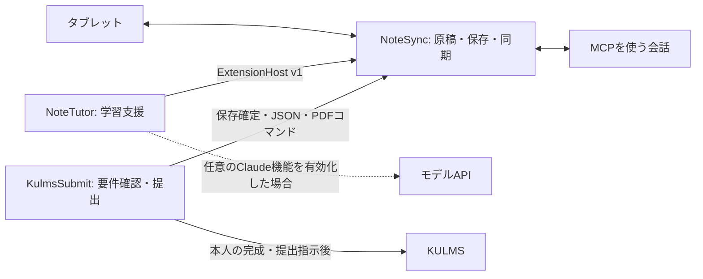

# ノート同期を中心とする3プロジェクト

## 責務と依存

NoteSyncはノートの正本を管理します。NoteTutorとKulmsSubmitは用途ごとの追加機能です。コアは両方に依存せず、各リポジトリが固有の設定・テスト・リリースを持ちます。ノート用Gitリポジトリはアプリのコードを管理し、個人のノートや秘密情報はアプリデータ／Git除外の設定へ置きます。

## 公開契約

| 接続 | 契約 |
| --- | --- |
| チューターのロード | Python entry point `notesync.extensions`。`NOTESYNC_DISABLE_EXTENSIONS=1`ならロードしない |
| 拡張ホスト | `notesync.api.ExtensionHost` v1。metadata/snapshot/on_ink_change/add_action/add_toolbar/register_operation/broadcast |
| タブレット拡張 | `tablet_assets()` はCSS・HTML・JSを返す。JSは独立スコープで `updateExtensionConnection` と `handleExtensionMessage` を提供する |
| WebSocket拡張 | `connection(server, websocket)` の返すセッションが認証後connected/handle、切断時closeを受ける。処理したメッセージのみTrueを返す |
| MCP追加指示 | 任意の `mcp_instructions()`。操作はホストへ登録。コアの同期指示には学習方針を含めない |
| ライブ原稿 | loopbackの認証付き `save_note_snapshot(note_id)`。筆記中・保存失敗・版の不一致を拒否し、確定保存先を返す |
| 保存原稿 | v2 `library/index.json` → 相対パス・SHA256で参照する `note.json`。不一致時は確定ハッシュの履歴を検証する。v1 JSONも読取可 |
| PDF | `notesync-export snapshot.json answer.pdf`。GUIウィンドウやチューターをロードせず原稿コピーだけを描画する |

## 保存の所有者

- NoteSync: `NoteSync/library/courses/<科目>/<note-id>/note.json` とattachments・history。科目で整理し、ノートIDを固定する。
- NoteTutor: 自身の `.env` とプロセス内の会話・転記キャッシュ。ノート原稿を書き換えず、必要な注釈は公開MCP操作を使う。
- KulmsSubmit: `data/mcp/` の提出用コピー、要件、確認記録、受付。資格情報はOSキーストア。原稿と提出用コピーのハッシュを比較する。

旧名からは照合済みコピーで移行し、旧ファイルを残します。`NoteSync/migration.json` はコピー元とファイルハッシュを記録し、コピー後の旧アプリからの変更を検出します。提出側もこのマーカーを読み、古いコピーの提出を止めます。接続記述子は新アプリで生成し直します。

## 選んだ境界

チューターは独立リポジトリのPython拡張にしました。GUI部品とQt上の筆跡通知を利用でき、起動プロセスや画像通信を重複させません。その代わりNoteSyncの拡張APIに対応する必要があり、実行環境は共有します。`notesync>=0.3,<1` とAPI version 1を契約にし、破壊的な変更は両側の統合テストで扱います。

提出は別プロセスのMCPです。大学認証と送信状態を編集アプリから分離でき、既存PDFだけならNoteSyncも不要です。ノート出力時だけ `NOTESYNC_PYTHON` で書き出しコマンドを呼びます。モデル呼び出しを持たず、内容判断は接続中のアシスタントが担当します。

## 受け入れ条件

1. チューター未導入／無効でもノート編集・保存・タブレット同期・MCP・PDFが使える。
2. チューターの通信・キー・学習指示はNoteTutorだけにある。
3. 提出側はNoteSyncの内部GUIをimportせず、公開JSON・loopback・コマンドで連携する。
4. 旧原稿を上書きせず移行し、旧アプリの後続編集を検出する。
5. 各リポジトリの回帰テストと、実loopback・PDFの接続テストが通る。

由来はHaruhiroObora/BeamerPlusですが、スライド用ウィンドウ・PDFビューア・サムネイルバーはNoteSyncの実行依存から外しました。再利用する描画・ペン処理と元のGit履歴・ライセンス表示は残しています。
